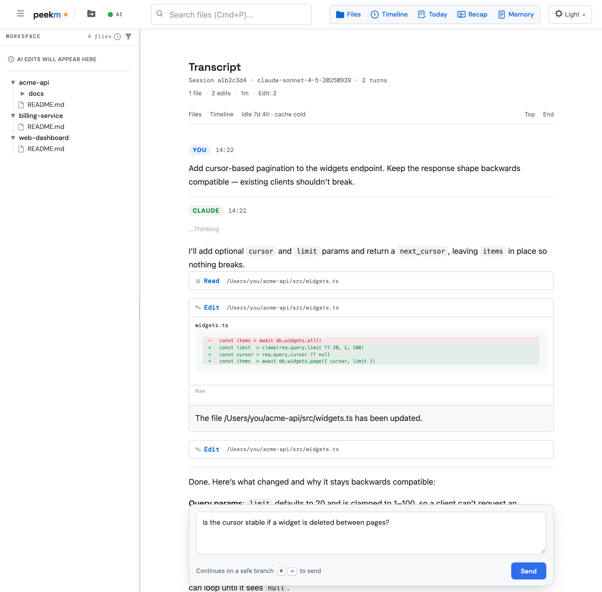

# peekm

**Read and review your Claude Code sessions, and share the files they write.**

[](https://github.com/razvandimescu/peekm)
[](https://github.com/razvandimescu/peekm/releases)
[](LICENSE)

A Claude Code session leaves a git diff and a JSONL log. peekm shows the session as a transcript with line diffs. It also shows what Claude Code remembers about each project. You can ask a follow-up question in a read-only fork of a session. **[peekm.dev](https://peekm.dev)**

[](https://peekm.dev/#demo)

> **[▶ Try the live demo](https://peekm.dev/#demo)**. You can open a diff, expand a response, and reply to a session in the page.

**peekm has no accounts and no telemetry. Your files leave your machine only when you share them or reply to a session.**

## Getting Started

```bash
npx @peekm/peekm .
```

Run the command in a project directory. To see all your projects, run it in their parent directory, for example `~/projects`. Then start a Claude Code session in one of these projects. The timeline shows the session while it runs.

AI tracking needs Claude Code or pi. The Claude Code hook also needs `jq`.

## Features

**Read and review:**

- **Transcripts**: A transcript shows the full conversation of a session, with tool calls, line diffs, and thinking blocks. It refreshes while the session runs.
- **Timeline**: The timeline shows the sessions of all projects in the directory that peekm browses, grouped by day. Each session shows its duration, files, and tools. An active session also shows its last tool call. A filter shows all sessions or only the sessions with edits.
- **Memory browser**: The memory browser shows what Claude Code remembers about each project on your machine. It reads `~/.claude/projects/*/memory/` and the `.claude/CLAUDE.md` of each project.
- **Replies**: You can reply to a transcript to ask a follow-up question. peekm runs the reply in a fork of the session with read-only tools (Read, Grep, Glob). The fork cannot edit files. It does not change the session in your terminal. Replies work only for Claude Code sessions.
- **Notifications**: A toast shows when an agent changes a file in the directory that peekm browses. An open file reloads when it changes.

**Share:**

- **Links**: Open a file and click **Share** to get a link for your local network. Click **Make public** to get an HTTPS link through `share.peekm.dev`. Each link expires after 1 hour. Recipients need no account. LAN recipients see changes live.
- **File types**: You can share Markdown, HTML, SVG, and TXT files. An HTML share includes the CSS, JS, and image files that the page uses. Recipients of a Markdown share can download it as DOCX.

**Plan and report:**

- **Today**: The Today page shows your plan for the day from `~/.peekm/days/YYYY-MM-DD.md`. You can carry over the open tasks from your last plan. The page refreshes when an agent edits the plan.
- **Recap**: The recap page shows the sessions, edited files, and git commits of one day in the directory that peekm browses. By default, it shows yesterday. **Save** writes the recap to `standup-YYYY-MM-DD.md` in that directory.

**Also included:**

- **File viewer**: The viewer shows Markdown, HTML, SVG, and TXT files in a sidebar tree. It has fuzzy search (Cmd/Ctrl+P), Mermaid diagrams, syntax highlighting, and light, dark, and auto themes. You can edit Markdown files in the browser. A click on a Mermaid diagram opens it full screen at its actual size. A click on a task-list checkbox updates the task in the file.
- **Recent AI Edits**: This smart folder lists the files that an agent changed in the last 24 hours.

## How It Works

peekm uses a Claude Code `PostToolUse` hook to match each file edit to the session that made it. When `~/.claude` exists, peekm installs the hook each time it starts:

- It writes the hook script to `~/.claude/peekm-hook.sh`.
- It adds the hook to `hooks.PostToolUse` in `~/.claude/settings.json`. Your other hooks stay unchanged.

After each tool call, the hook sends an event to peekm on `localhost`. It tries the port that peekm runs on, then ports 6419, 8080, and 3000. The event contains these fields:

- **Write, Edit, NotebookEdit**: the session ID, file path, tool name, permission mode, tool use ID, and working directory. The hook also appends this event to `~/.peekm/events.jsonl`. peekm reads this file when it starts, so it also shows the edits that sessions made while peekm was off.
- **Plan files** in `~/.claude/plans/`: the event also contains the plan text.
- **Other tools**: the session ID, the tool name, and the first 300 bytes of the tool's description, command, file path, pattern, or prompt. The hook does not store these events.

When `~/.pi/agent` exists, peekm also writes a pi extension to `~/.pi/agent/extensions/peekm.ts` each time it starts. The extension sends the same types of events as the Claude Code hook.

To remove the hook, run `peekm setup claude-code --remove`. For pi, run `peekm setup pi --remove`. peekm installs them again when it starts. To keep them removed, start peekm with `-no-ai-tracking`.

### Network Use

The hook and the pi extension send events only to `localhost`. peekm connects to other hosts in these cases:

- Once a day, when peekm runs in a terminal, it checks `registry.npmjs.org` for a new version. The request contains no file or session data.
- The browser loads the Mermaid library from `cdn.jsdelivr.net`.
- When you make a share public, the file goes through the `share.peekm.dev` relay. For an HTML file, the relay also sends the assets that the page loads.
- A reply sends your question and the files that the fork reads to the Anthropic API, as any Claude Code session does.

## Installation

npm:

```bash
npm i -g @peekm/peekm  # upgrade: npm update -g @peekm/peekm
```

Homebrew:

```bash
brew install razvandimescu/tap/peekm  # upgrade: brew upgrade peekm
```

Go:

```bash
go install github.com/razvandimescu/peekm@latest  # run again to upgrade
```

To run peekm without an installation, use `npx @peekm/peekm .`. Binaries for macOS, Linux, and Windows are on the [releases page](https://github.com/razvandimescu/peekm/releases).

## Usage

```bash
peekm .              # browse the current directory
peekm ~/projects     # browse all projects in ~/projects
peekm README.md      # open a file and browse its git repository
peekm -port 8080 .   # serve on port 8080
```

| Flag | Default | Description |
|------|---------|-------------|
| `-port` | `6419` | Port to serve on |
| `-browser` | `true` | Open the browser at start |
| `-no-ai-tracking` | `false` | Do not install the hooks or track sessions |
| `-trusted-cidr` | (none) | Comma-separated CIDRs that can connect in addition to localhost |
| `-allow-host` | (none) | Comma-separated hostnames to accept in addition to `localhost` and IP addresses |
| `-show-ignored` | `false` | List the excluded directories and exit |
| `-version` | `false` | Show the version and exit |

peekm accepts connections only from localhost. To accept other devices, add their network with `-trusted-cidr`. For example, `peekm -trusted-cidr 100.64.0.0/10 .` accepts the devices on your Tailscale tailnet. Add only networks that you trust. Any device in these networks can read the files that peekm serves. To connect with a hostname instead of an IP address, add the hostname with `-allow-host`.

## Background Service

Install peekm first (see [Installation](#installation)). Then run:

```bash
peekm setup autostart           # start peekm at login
peekm setup autostart --remove  # remove the service
```

The service uses launchd on macOS, systemd on Linux, and the Startup folder on Windows. It starts peekm without a browser window. On macOS and Linux, it browses your home directory.

The hook records edits even when peekm is off. The service keeps peekm available for notifications and the live tool status.

<details>
<summary><strong>Ignoring Directories</strong></summary>

peekm skips dot-directories (except `.claude`), linked git worktrees, and these directories: `node_modules`, `vendor`, `dist`, `venv`, `env`, `virtualenv`, `target`, `__pycache__`.

To skip more directories, add a `.peekmignore` file with one pattern per line. A pattern matches a directory name, so it cannot contain `/`. You can use `*`, `?`, and `[...]`. The patterns apply to the directory of the file and to all directories below it. peekm reads the `.peekmignore` files in each directory from `$HOME` down.

```
_site
build
fixtures-*
```

To see the exclusions for a directory, run `peekm -show-ignored [dir]`.

</details>

## Requirements & Limits

- The binary runs on macOS, Linux, and Windows, with no runtime dependencies.
- AI tracking needs Claude Code or pi. The Claude Code hook script also needs `bash`, `curl`, and `jq`.
- Replies need the `claude` CLI on your `PATH`.
- peekm runs on one machine. It does not sync data between machines or users.

## FAQ

**Does peekm send my code anywhere?**
Only when you share a file or reply to a session. See [Network Use](#network-use).

**Does a reply cost anything?**
peekm is free. A reply runs `claude -p` with your Claude Code login, so the usage rules of your plan apply. Each reply sends the session history with your question, as a resumed session does in the terminal.

**Why not read the JSONL or the git log?**
You can. peekm matches each change to its session, renders the conversation, and shows the sessions of many projects on one timeline.

**Does it work with Cursor, Copilot, or Aider?**
No. peekm supports Claude Code and pi. To request another agent, [open an issue](https://github.com/razvandimescu/peekm/issues).

## Development

You need Go 1.25 or later. `make all` builds peekm, runs the tests with `-race`, and runs the linters.

## Contributing

Pull requests are welcome. If something breaks, [open an issue](https://github.com/razvandimescu/peekm/issues).

## License

Apache 2.0. See [LICENSE](LICENSE).
